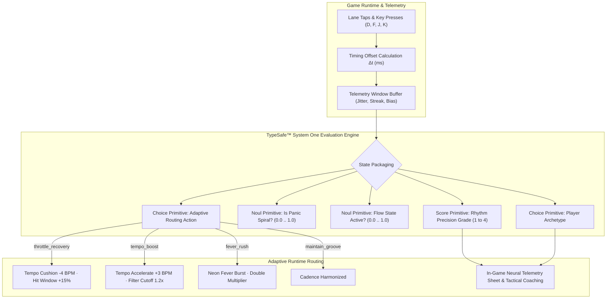

<div align="center">

# ⚡ PIXEL PULSE RUSH
### *Neon 8-Bit Chiptune Rhythm Game × Apple Liquid Glass × TypeSafe™ System One AI*

[](https://react.dev/)
[](https://vitejs.dev/)
[](https://tailwindcss.com/)
[](https://tanstack.com/router)
[](https://developer.apple.com/design/)
[](https://typesafe.ai)

<br/>

<p align="center">
  <b>Pixel Pulse Rush</b> is a high-speed, 4-lane neon rhythm game featuring procedural chiptune audio synthesis, engineered with Apple's signature <b>Liquid Glass design system</b>, fluid spring micro-interactions, beat timing drift correction, cloud reliability telemetry, and real-time cognitive rhythm evaluation powered by <b>TypeSafe™ System One models</b>.
</p>

[🎮 Live Experience](#-gameplay--controls) • [✨ Apple Design System](#-apple-design-system--fluid-motion) • [🧠 TypeSafe AI Architecture](#-typesafe-ai-system-one-architecture) • [📊 Reliability & Analytics](#-reliability-diagnostics--pause-coordination) • [🎵 Procedural Audio](#-procedural-chiptune-synthesizer) • [🛠️ Getting Started](#-getting-started)

---

</div>

<br/>

## 🌟 Highlights

- **💎 Apple Liquid Glass Aesthetic**: Multi-layered frosted glass vibrancy (`backdrop-blur-28px saturate-190%`), specular edge reflections, and restrained two-layer functional hierarchy conforming to Apple HIG.
- **⚡ Fluid Physical Motion**: Zero-latency pointer-down response (`scale(0.97)` active states), interruptible transitions, Apple-style segmented difficulty controls, and haptic Taptic feedback.
- **🧠 TypeSafe™ System One Intelligence**: Programmable common sense running over player telemetry streams—featuring `Score`, `Noul`, and `Choice` primitives for jitter analysis, panic detection, flow state scoring, and dynamic audio/difficulty routing.
- **⏱️ Beat Timing Drift Correction**: Zero-jitter timeline reconciliation after short or long pauses—prevents note desync and false flatlines when resuming.
- **📊 Cross-Session Cloud Save Analytics**: Full instrumentation of retry attempts, backoff timings, payload sizes, and failure reasons stored across sessions.
- **📋 One-Tap Debug State Export**: Instant JSON snapshot export of retry queues, analytics logs, and runtime diagnostics to the system clipboard.
- **🔄 YouTube & Visibility Coordination**: Symmetrical state machine coordinating `document.visibilitychange` with YouTube Playables `system.onPause` / `system.onResume`.
- **🎹 100% Procedural Web Audio Engine**: Every run generates a unique chiptune melody and harmony across square, triangle, and noise oscillator channels with real-time FFT frequency visualization.

---

## 🎨 Apple Design System & Fluid Motion

Pixel Pulse Rush translates the physical elegance and material restraint of Apple's Human Interface Guidelines (HIG) and WWDC Fluid Interface principles directly to the modern web:

### 1. Two-Layer Depth Architecture
- **Content Layer**: The high-contrast neon arcade canvas, frequency visualizer, and cascading pixel notes reside in a clean, high-visibility dark canvas.
- **Functional Layer**: Controls, navigation bars, modal sheets, and the Telemetry Inspector float above the content using **Liquid Glass** (`rgba(18, 18, 22, 0.72)` with `backdrop-filter: blur(28px) saturate(190%)`), hairline specular edges, and ambient radial diffuse illumination.

### 2. Apple Segmented Controls & Keycaps
- **Segmented Difficulty Picker**: Features an iOS-style translucent track with smooth pill indicator transitions (`EASY`, `NORMAL`, `HARD`).
- **Hardware-Feel Keycaps**: Physical-styled `<span class="apple-keycap">` components rendered with subtle top bevels and drop shadows representing the `D`, `F`, `J`, `K` home row keys.

### 3. Tactile Feedback & Spring Physics
- **Zero Input Latency**: Pointer-down feedback fires instantly rather than waiting for click-up.
- **Taptic Engine Simulation**: Synthesizes micro-vibrations (`navigator.vibrate`) on note hits and lane taps—subtle 14ms clicks for Perfects and 22ms pulses for Goods.
- **Active State Depression**: Buttons and interactive controls compress naturally with `active:scale-[0.97]` on tap.

---

## 🧠 TypeSafe™ AI System One Architecture

Instead of slow, hallucination-prone freeform text generation, Pixel Pulse Rush integrates **TypeSafe's System One architecture (Jev model)**. Code owns the core gameplay loop, while small, focused System One AI primitives supply programmable common sense to evaluate player rhythm and route adaptive gameplay parameters in real time.



### The Primitives in Pixel Pulse Rush

| Primitive | Identity | Contract & Semantics | Output / Behavior |
| :--- | :--- | :--- | :--- |
| **Score** | `rhythm_precision` | Probability-weighted position on 4 ordered levels: Novice (1), Developing (2), Locked-In (3), Virtuoso (4) | Evaluates sub-20ms standard deviation (`jitterMs`) and provides a continuous precision score (e.g. `3.85 / 4.0`). |
| **Noul** | `is_panic_spiral` | Single calibrated probability (`0.0` to `1.0`) measuring whether motor cadence broke down after a missed note | When `P(panic) >= 0.50`, routes the engine into recovery mode to prevent rage-quits. |
| **Noul** | `flow_state` | Single calibrated probability that player is in psychological flow (sustained combo, low variance, neutral delta bias) | When `P(flow) >= 0.50`, triggers enhanced audio harmonics and visual pulse glow. |
| **Choice** | `adaptive_routing_action` | Competing probability distribution across 4 discrete intervention actions | Selects `maintain_groove`, `throttle_recovery`, `tempo_boost`, or `fever_rush` and dynamically alters the procedural synth. |
| **Choice** | `player_archetype` | Classifies player behavioral style from timing bias | Identifies `precision_sniper`, `flow_runner`, `speed_rusher`, or `adaptive_groover`. |

---

## 📊 Reliability, Diagnostics & Pause Coordination

### 1. Cloud Save Retry Analytics Stream
- **Persistent Ring Buffer**: Telemetry events for `save_queued`, `save_attempt`, `save_success`, `save_retry_scheduled`, and `save_abandoned` are stored across sessions in `localStorage` under `ppr:analytics:cloud_save:v1`.
- **Full-Jitter Exponential Backoff**: Prevents hammering YouTube storage endpoints on rate-limits, tracking retry countdowns and failure causes.
- **Custom Event Dispatch**: Emits `ppr:cloud_save_analytics` on `window` for external telemetry listeners.

### 2. One-Tap Debug State JSON Export
- Integrated directly into the `DebugOverlay` (` ` ` key or `?debug=1` parameter).
- Tap **📋 Copy JSON** to generate and copy a complete diagnostic manifest containing:
  - Timestamp, user agent, URL, and device pixel ratio
  - Cloud schema version, migration status, and save queue depth
  - Cross-session analytics summary and recent event histories
  - Ad status, last error, and error log buffer

### 3. Beat Timing Drift Correction
- When the game pauses, the engine records exact audio clock and performance timestamps (`pauseAudioTime`, `pauseWallTime`).
- On unpause, `unpause()` calculates clock deviation `drift = ctx.currentTime - pauseAudioTime`.
- If audio time advanced during pause (e.g. tab suspension or background throttling):
  - Procedural beat start time shifts: `startTime += drift`
  - In-flight unjudged notes shift: `spawnAt += drift`, `hitAt += drift`
  - `nextBeat` schedule index is automatically aligned to prevent burst-scheduling of past notes.

### 4. Visibility & YouTube Playables Coordination
A unified state machine coordinates browser tab changes with YouTube Playables lifecycle:
- **Tab Hidden (`document.hidden = true`)**: Gameplay automatically pauses, AudioContext suspends, and audio gain is silenced.
- **Tab Visible (`document.hidden = false`)**: If the pause was triggered automatically by visibility (and YouTube is not actively holding pause), gameplay and audio unpause seamlessly with drift correction.
- **YouTube Playables (`onPause` / `onResume`)**: Coordinates with visibility so playback resumes only when both YouTube environment and document visibility allow it.

---

## 🕹️ Controls & Calibration

| Input | Desktop | Mobile / Touch | Action |
| :---: | :---: | :---: | :--- |
| **Lane 1** | <kbd>D</kbd> | Tap Lane 1 (Pink) | Hit leftmost cascade notes |
| **Lane 2** | <kbd>F</kbd> | Tap Lane 2 (Cyan) | Hit center-left notes |
| **Lane 3** | <kbd>J</kbd> | Tap Lane 3 (Yellow) | Hit center-right notes |
| **Lane 4** | <kbd>K</kbd> | Tap Lane 4 (Green) | Hit rightmost cascade notes |
| **Start / Restart** | <kbd>SPACE</kbd> | Press Start Button | Launch procedural track run |
| **Pause / Resume** | <kbd>ESC</kbd> or <kbd>P</kbd> | Tap Pause Button | Toggle game pause |
| **AI Inspector** | Tap Neural Pill | Tap Neural Pill | Open TypeSafe System One Inspector |
| **Debug Overlay** | <kbd>`</kbd> (Backtick) | `?debug=1` parameter | Diagnostics, cloud queue, JSON export & FPS metrics |

### Hardware Audio Calibration
Tap the **CALIBRATE** button on the home screen to access the precision audio latency offset tuner. Tap in sync with the audible rhythm beeps to calculate and persist hardware offset (`-150ms` to `+150ms`) in `localStorage`.

---

## 🎵 Procedural Chiptune Synthesizer

Pixel Pulse Rush includes a custom Web Audio API chiptune synthesis engine:
- **Lead Melody**: 8-bit square oscillator with variable pulse duty cycle and snappy exponential decay.
- **Bassline**: Triangle and sawtooth oscillator driving sub-bass arpeggios synchronized to the track BPM.
- **Percussion**: White noise burst generator simulating retro 8-bit snare and hi-hats.
- **Dynamic Filter**: Real-time biquad low-pass filter modulated dynamically by TypeSafe AI flow state judgments.

---

## 📁 Repository Architecture

```text
Pixel-Pulse-Rush/
├── public/                         # Static assets & icons
├── src/
│   ├── components/
│   │   ├── PixelPulseRush.tsx              # Main game engine, canvas render loop, pause coordination & Apple UI
│   │   ├── TypeSafeNeuralInspector.tsx     # Liquid Glass TypeSafe System One modal
│   │   └── ui/                             # Reusable Radix & Tailwind components
│   ├── lib/
│   │   ├── cloud-save-analytics.ts         # Cloud save retry telemetry, backoff tracking & persistent logging
│   │   ├── typesafe-ai-routing.ts          # TypeSafe System One Jev model evaluation & routing logic
│   │   ├── ytgame.ts                       # YouTube Playables SDK & cloud save wrapper
│   │   ├── lovable-error-reporting.ts      # Runtime diagnostic logging
│   │   └── utils.ts                        # Classnames & styling helpers
│   ├── routes/
│   │   ├── __root.tsx                      # Root shell with Apple web-app metadata & fonts
│   │   └── index.tsx                       # Index route mounting PixelPulseRush
│   └── styles.css                          # Apple Design System tokens, Liquid Glass & neon utilities
├── bunfig.toml                     # Bun configuration
├── package.json                    # Project dependencies & scripts
├── tsconfig.json                   # TypeScript configuration
└── vite.config.ts                  # Vite & TanStack Router bundler config
```

---

## 🛠️ Getting Started

### Prerequisites
- Node.js (v20 or higher recommended)
- npm or bun

### Installation

```bash
# Clone repository
git clone https://github.com/Rahul08319/Pixel-Pulse-Rush.git
cd Pixel-Pulse-Rush

# Install dependencies
npm install --legacy-peer-deps
```

### Development Server

```bash
npm run dev
```

Visit `http://localhost:5173` in your browser.

### Production Build

```bash
npm run build
npm run preview
```

---

## 📜 License & Credits

Built with ❤️ by [Rahul](https://github.com/Rahul08319) powered by:
- **Apple Human Interface Guidelines (HIG)**
- **TypeSafe™ AI System One Architecture**
- **Web Audio API & TanStack Start**
